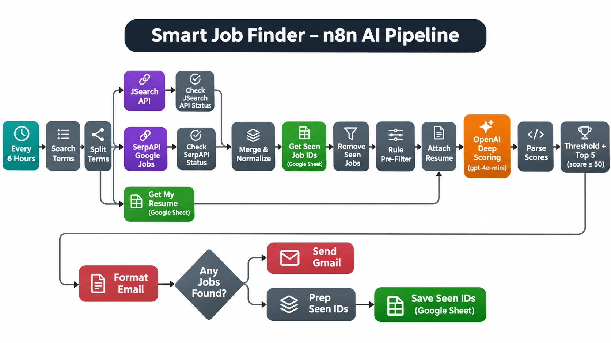

# Smart Job Finder

An n8n AI agent that finds, scores, and emails me matching remote jobs.

**Demo video:** https://www.youtube.com/watch?v=Y1jvCwc8wrA

## Pipeline

## How it works

1. **Schedule** – the workflow runs every 6 hours.
2. **Search** – a list of search terms is split into one item per term, and each term is sent to the **JSearch API** (RapidAPI) and **SerpAPI Google Jobs** in parallel. Each response passes through a status check that fails the run loudly if the API returned an error.
3. **Normalize** – results from both sources are merged into one format: `id`, `title`, `company`, `location`, `description`, `url`, `posted`, `source`.
4. **Deduplicate** – job IDs already emailed (read from a "Seen Jobs" Google Sheet, within the last 7 days) are removed, along with duplicates inside the same batch.
5. **Rule pre-filter** – a free, rule-based filter drops jobs with hard blockers (e.g. US-only, relocation, clearance), core ML-research stacks, senior roles with high year requirements, and jobs that mention none of the target stack terms.
6. **Attach resume** – resume text is read from a Google Sheet and attached to each job.
7. **AI scoring** – `gpt-4o-mini` scores each job 0–100 against a fixed rubric (stack match, remote/any-nationality, experience fit, blockers) and returns JSON with `score`, `stack_match`, `location_ok`, `experience_fit`, `blockers`, `has_red_flags`, and `verdict`.
8. **Select** – jobs with `score >= 50`, `location_ok`, and no red flags are sorted by score and the top 5 are kept.
9. **Deliver** – an HTML email with one card per job is sent via Gmail, and the emailed job IDs are appended to the "Seen Jobs" sheet so they are not sent again.

## Stack

- n8n
- OpenAI API
- JSearch API (RapidAPI)
- SerpAPI (Google Jobs)
- Google Sheets
- Gmail

## Setup

1. **Import the workflow** – in n8n, choose *Import from File* and select [`workflow/smart-job-finder.json`](workflow/smart-job-finder.json).
2. **Create credentials** in n8n and assign them to the matching nodes (credential IDs in the file are placeholders):
   | Credential | n8n type | Used by |
   |---|---|---|
   | OpenAI | OpenAI API | OpenAI Deep Scoring |
   | JSearch / RapidAPI | Multiple Headers Auth (header `X-RapidAPI-Key`) | JSearch API |
   | SerpAPI | Query Auth (parameter `api_key`) | SerpAPI Google Jobs |
   | Google Sheets | Google Sheets OAuth2 | Get Seen Job IDs, Get My Resume, Save Seen IDs |
   | Gmail | Gmail OAuth2 | Send Gmail |
3. **Create the two Google Sheets** and select them in the Google Sheets nodes (replacing `YOUR_SEEN_JOBS_SHEET_ID` / `YOUR_RESUME_SHEET_ID`):
   - **Seen Jobs** – headers in row 1: `job_id`, `date_seen`
   - **Resume** – header `resume_text` in row 1, your resume text in row 2
4. **Set your email** – in *Send Gmail*, replace `YOUR_EMAIL@example.com` with your address.
5. **Set your experience level** – in *OpenAI Deep Scoring*, replace `YOUR_EXPERIENCE_LEVEL` in the rubric.
6. **Edit the search terms** – open the *Search Terms* node and change the `searchTerms` array.
7. Run once manually to test, then activate the workflow.

See [`.env.example`](.env.example) for the list of keys you need and [`docs/node-reference.md`](docs/node-reference.md) for a node-by-node description.

## Customization

- **Search terms** – edit the `searchTerms` array in the *Search Terms* node.
- **Threshold** – change `THRESHOLD = 50` in the *Threshold + Top 5* node (and `slice(0, 5)` to change how many jobs are emailed).
- **Schedule** – change `hoursInterval: 6` in the *Every 6 Hours* trigger.

## Results

From the demo run: **36 jobs scored, 5 emailed, top score 85/100.**

## License

[MIT](LICENSE) © Maryum Akram
